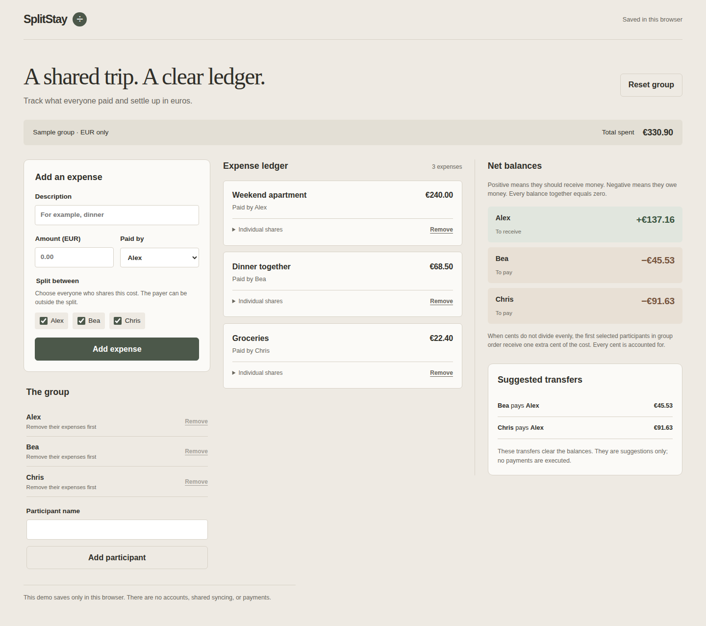

# SplitStay

A browser-local EUR expense ledger that explains who paid, each person's share, and suggested transfers.



[View the mobile screenshot](docs/screenshots/mobile.png).

## What it does

- Add participants and record expenses with a description, EUR amount, payer, and selected participants.
- Inspect individual shares, net balances, and suggested transfers.
- Allow a payer outside the selected split; protect participants referenced by expenses from removal.
- Confirm expense/participant removals and group resets, persist the group, and show storage recovery and retry actions.

## Run locally

Use Node.js 24 and npm. No environment variables, API keys, or backend setup are required.

```sh
npm ci
npm run dev -- --webpack
```

Open [localhost:3000](http://localhost:3000). If your environment limits file watchers, use `WATCHPACK_POLLING=true npm run dev -- --webpack`.

## Check and build

```sh
npm run lint
npm run type-check
npm test
npm run build
npm start
```

The build script uses Next.js's supported Webpack option. To run the checked-in desktop Chrome and Pixel 7 workflows:

```sh
npx playwright install chromium
npm run test:e2e
```

[Verified GitHub Actions run](https://github.com/lahcen-aloui/splitstay/actions/runs/38149295202): lint, strict type checking, all 81 unit tests, the production build, and all 24 desktop Chrome / Pixel 7 browser cases passed. The screenshots above were captured by that successful browser job and inspected at both sizes.

## Stack and structure

Next.js 16 App Router, React 19, strict TypeScript, CSS variables and inline styles, ESLint, Vitest, and Playwright. Dependency versions are pinned in `package-lock.json`. UI text lives in `locales/en.ts`; calculations and storage validation live in `lib/`; focused client components live in `components/`. Icons and fonts require no external asset service.

## Demo data and persistence

The first visit starts with Alex, Bea, and Chris and three fictional expenses. Resetting the group restores these samples and clears expense/participant drafts, payer and split selections, and validation errors only after the reset is successfully saved. Cancellation and failed reset preserve those drafts. Data is stored under `splitstay.group.v1` in this browser's localStorage. There are no accounts, shared synchronization, or payments. Clearing browser data removes the group. Invalid saved data is preserved until confirmed reset; failed writes keep the current state visible and offer a retry.

Saving requires a browser supporting [Web Locks](https://developer.mozilla.org/en-US/docs/Web/API/Web_Locks_API) on HTTPS or localhost. Each app serializes writes across tabs on the same origin and checks the exact loaded payload inside the lock, including first-visit seeding, retries, and confirmed resets. If another tab changes saved data, this tab pauses writes and keeps its in-memory state and form drafts. Choose **Discard drafts and load saved data** to explicitly replace that state with the latest validated snapshot. A stale reset confirmation is rejected; corrupt or unsupported payloads are never treated as a first visit or silently overwritten. Without Web Locks, saving fails with an explicit notice rather than using an unsafe fallback. No automatic merging is provided.

## Calculation and design choices

EUR input is parsed from decimal text using BigInt and then stored as safe integer cents. Fractional cents, zero/negative amounts, unknown participants, duplicate selections, and unsafe totals are rejected. Splits allocate equal whole-cent shares; remainder cents go to the first selected participants in persisted group order. For example, €10.00 across three people becomes €3.34, €3.33, and €3.33.

Payer credits minus participant shares yield net balances summing to zero. Creditors and debtors are sorted by ID, then each suggested transfer clears the smaller outstanding balance. Transfers clear the balances; no minimal-transfer-count claim or payment execution is made. Warm neutral panels separate the ledger from balances, with explicit receive/pay labels as well as color.

Unit tests cover guarded concurrent writes, failed-save retry snapshots, explicit reload/reset recovery, and exact parsing, rounding, subsets, outside payers, reference protection, nested storage validation, unsafe totals, and settlements. The successful CI browser run verifies expense, recovery, and failed-write flows at desktop and mobile sizes against the published source.

The browser suite retains the original desktop/mobile flows and actual screenshot capture. It now also checks two pages in the same context/origin for stale updates, deletion/reset, queued writes, failed-save retries, draft preservation, and corrupt data; dialog initial focus, focus containment, Escape dismissal and return focus; recovered writes followed by reload; and absence of application runtime errors on every page. Confirmation actions pause during a pending save, and the development indicator is disabled for clean screenshot captures. All 24 browser cases passed with no collected application runtime errors. Both actual CI screenshots were inspected for layout and overlay absence.

## Dependency audit

The latest audit found no production dependency vulnerabilities. One unpatched development-only advisory remains in the Next ESLint plugin’s glob dependency chain: [braces stack exhaustion](https://github.com/advisories/GHSA-vfj7-8cjw-p6xm). The suggested downgrade would move the lint plugin to Next 14; matching Next 16 tooling is retained. These tools process trusted project files and patterns.

## AI assistance

Built with AI assistance for implementation, tests, and documentation. The source and limitations are documented here; this project makes no claim about production usage or business results.

## More projects

By [Lahcen Aloui](https://github.com/lahcen-aloui). [ApplyFlow](https://github.com/lahcen-aloui/applyflow)

[MIT license](LICENSE).
